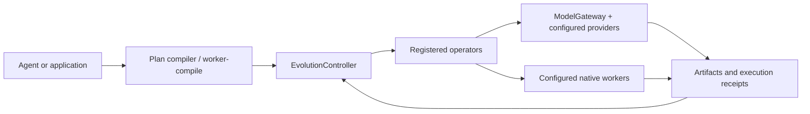

# DataEvolver

[中文](README_zh.md) · [Agent setup](AGENT_SETUP.md) · [Architecture](docs/FRAMEWORK_INTEGRATION.md)

DataEvolver is a development base for goal-driven data workflows. An agent proposes
plans and candidates. One `EvolutionController` owns execution, artifact checks,
budgets, event logs and recovery. `ModelGateway` binds model roles to explicit
profiles; registered operators bind execution to host-owned implementations.

The public base selects no default checkpoint or agent tool. Paths, model IDs,
endpoints, executables and resource permissions belong to deployment configuration.
Keep private profiles and credentials in ignored `.dataevolver/local/` files.
The previous VLM render/review dual loop is preserved on `codex/legacy-vlm-dual-loop`.

## Architecture



- `harness/`: state machine, contracts, event log, operator SDK and recovery.
- `dataset/`: artifact references, graph execution and validation.
- `adapters/`: typed model interfaces, provider transports and native journals.
- `workflows/`: optional implementations selected by an explicit deployment.

A completed workload proves execution and artifact integrity. Visual quality,
physical calibration and training benefit require separate evidence. Benchmark
probes and benchmark flaw discovery are outside this update.

## Develop the base

Use an editable source checkout with Python 3.12; the CLI reads repository
`configs/` alongside `src/`.

```bash
python3 -m venv .venv
. .venv/bin/activate
python -m pip install -e '.[harness]'
python -m dataevolver --help
python -m dataevolver operator-sdk catalog
python .agents/skills/verify-dataevolver/scripts/check_repository.py
```

`dataevolver`, `dataevolver-harness` and `python -m dataevolver` share one CLI.
The base setup requires no checkpoint, model service or native rendering engine.
The source checker reads source/configuration files without importing application
code or executing workloads. See [Agent setup](AGENT_SETUP.md) for deployment.

## Configure models and workers

Bind a model with `ModelProfile`, `ModelPolicy` and `ModelGateway`. Select its model
ID, revision, transport, endpoint environment variable, allowed roles and budgets.
The HTTP model transport accepts the host's served model ID. Native providers use
explicitly registered implementations. See
[the profile template](configs/harness/model_profiles.example.json).

For dataset plans, use `compile-plan` with registered operator and domain bindings.
For a native process, fill [the worker template](configs/worker.example.json) with
its executable, code, inputs, outputs, environment allowlist and resource limits.
Paths in `files` and `inputs` resolve relative to the profile file.
`worker-compile` freezes these resources into a goal; `create`, `step`, `status`
and `replay` use the same Controller. `scene-compile` remains a compatible alias.
A worker must implement the request/result contract documented in
[the native workflow guide](docs/NATIVE_SCENE_WORKFLOW.md).

The repository includes optional image, prompt-enhancement, review, segmentation,
Blender and UE5 adapters. Each adapter has its own dependencies and identity checks.
They are enabled by explicit profiles; choosing one does not make it a framework
default. See [optional visual adapters](docs/LOCAL_VISUAL_MODELS.md) and
[optional scene adapters](docs/NATIVE_SCENE_WORKFLOW.md). A different model
implementation must provide its own registered adapter when its API differs.

Low-level multimodal requests take explicit model values or
`DATAEVOLVER_<ROUTE>_MODEL` / `DATAEVOLVER_<ROUTE>_MODEL_PATH` environment bindings.
An unset binding stays unset; it never selects a checkpoint directory.

## Migration and verification

The old production and standalone multimodal CLIs, shell batch runners and
bootstrap script are retired. Use the unified Harness CLI. Existing frozen runs
retain their original hashes; changed code or bindings require a new campaign.
See [migration notes](docs/MAINLINE_MIGRATION.md).

Install `.[test]` and run the contract suite only with authorization on the intended
test host. The current integration received static source/configuration checks;
its tests, model inference and rendering have not been executed.

[Project website](https://pris-cv.github.io/DataEvolver/) ·
[First technical report](https://arxiv.org/abs/2605.01789) ·
[DataRSI research repository](https://github.com/PRIS-CV/DataRSI)

## Citation

The first technical report describes an earlier system revision.

```bibtex
@misc{zhang2026dataevolverletdatabuild,
  title={DataEvolver: Let Your Data Build and Improve Itself via Goal-Driven Loop Agents},
  author={Qisong Zhang and Wenzhuo Wu and Zhuangzhuang Jia and Yunhao Yang and Huayu Zhang and Xianghao Zang and Zhixiang He and Zhongjiang He and Kongming Liang and Zhanyu Ma},
  year={2026},
  eprint={2605.01789},
  archivePrefix={arXiv},
  primaryClass={cs.AI},
  url={https://arxiv.org/abs/2605.01789},
}
```
