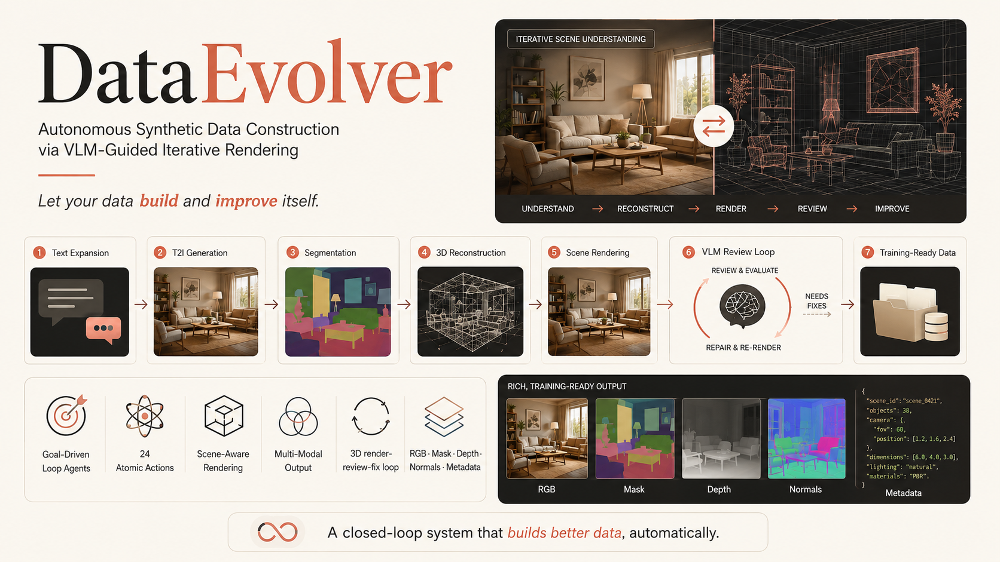
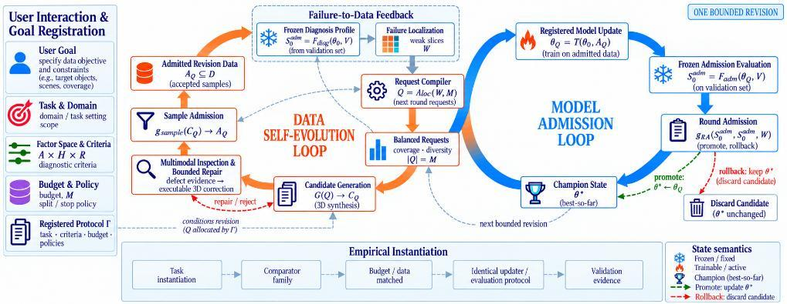
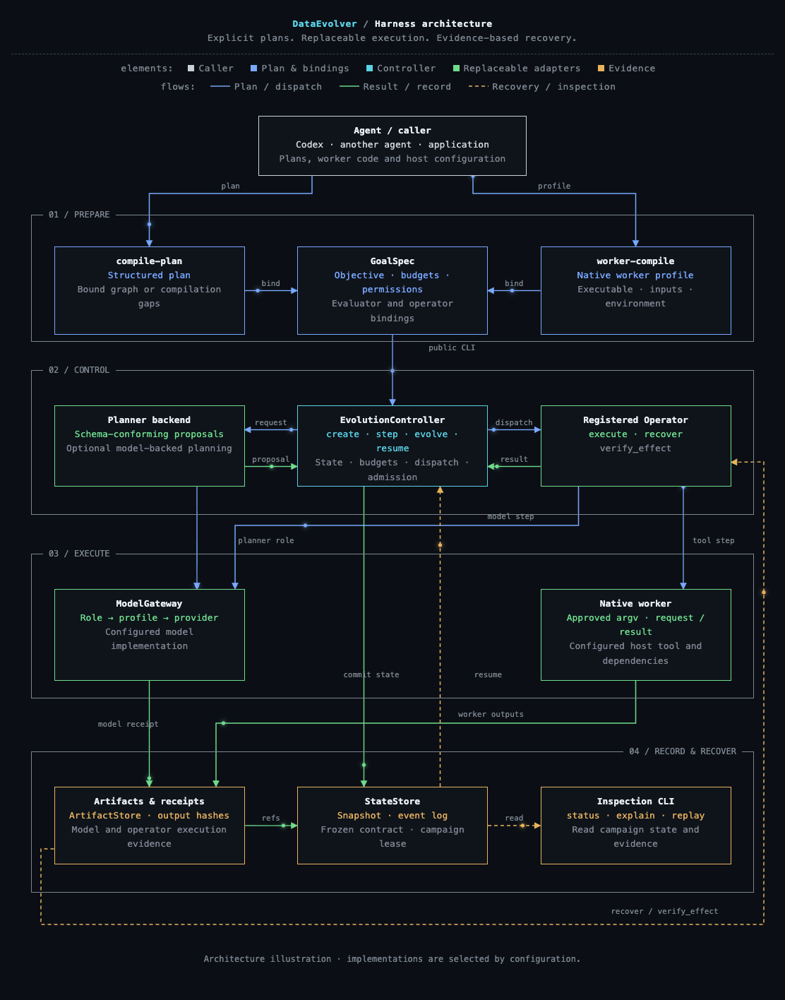
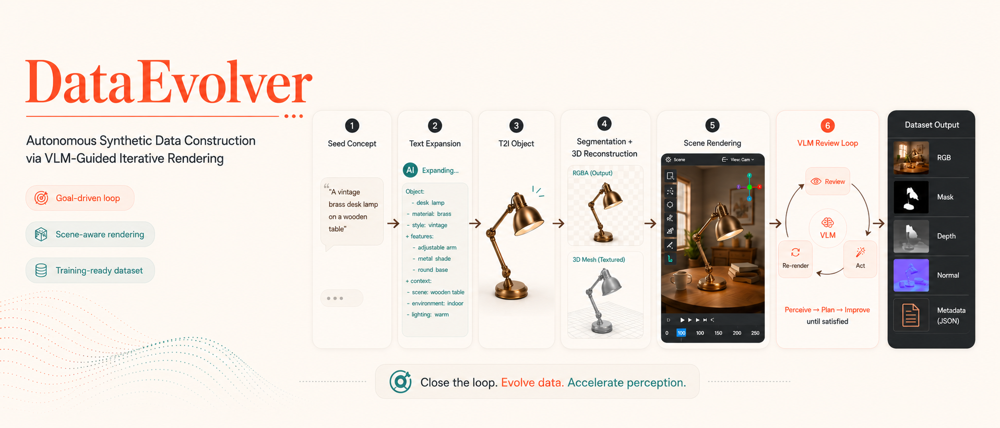
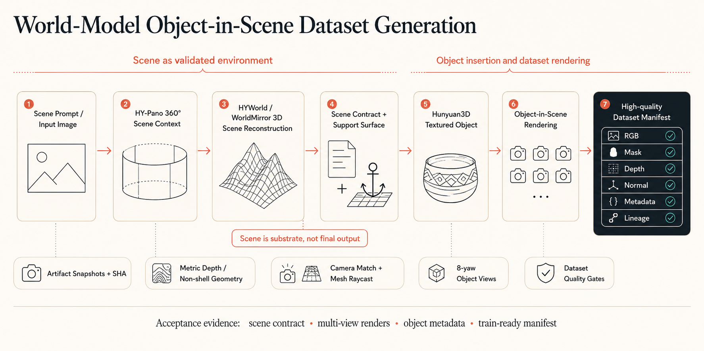

<p align="center">
  
</p>

<h1 align="center">DataEvolver</h1>

<p align="center">
  <strong>A durable Harness for data workflows driven by agents.</strong><br/>
  Plan with an agent. Execute through registered operators. Recover from recorded evidence.
</p>

<p align="center">
  <a href="https://pris-cv.github.io/DataEvolver/"></a>
  <a href="https://arxiv.org/abs/2605.01789"></a>
  <a href="LICENSE"></a>
</p>

<p align="center">
  <strong>English</strong> · <a href="README_zh.md">简体中文</a> ·
  <a href="AGENT_SETUP.md">Agent setup</a> ·
  <a href="docs/FRAMEWORK_INTEGRATION.md">Framework guide</a>
</p>

<p align="center">
  <a href="#quick-start">Quick Start</a> · <a href="#pipeline-overview">Harness</a> ·
  <a href="#replace-models-and-tools">Models &amp; Tools</a> ·
  <a href="#inspect-pause-and-recover">Recovery</a>
</p>

`main` is a portable development base for composing data processing, model calls
and native tools. Codex or another application supplies plans and candidate code;
the Harness manages the resulting runs. Models, executables, paths and resource
permissions are explicit deployment choices. Keep private configuration and
credentials under ignored `.dataevolver/local/` files or in the host environment.



*The original project poster illustrates the earlier render/review design.*

## DataEvolver and DataRSI

**DataEvolver is the engineering project; DataRSI is the subsequent research work.**
The first [technical report](https://arxiv.org/abs/2605.01789) describes the earlier
goal-driven loop agents. [DataRSI](https://github.com/PRIS-CV/DataRSI),
*A 3D Data Harness for Failure-to-Data Evolution*, studies data revision and model
admission under registered budgets and rules. Its public repository currently
announces that implementation and reproduction materials are being prepared.

This repository's `main` supplies the current Harness base. The earlier VLM dual
loop is retained on [the legacy branch](https://github.com/PRIS-CV/DataEvolver/tree/codex/legacy-vlm-dual-loop).
The [project/publication guide](docs/DATARSI_RELATION.md) explains their scopes.

## Why DataEvolver?

Data construction involves more than selecting a model: plans need compatible
operators, processes need explicit inputs and outputs, and interrupted runs need
recoverable evidence. DataEvolver gives those concerns shared contracts and one
Controller. An agent can propose a different workflow without creating another
execution state machine.

## Project Page trace showcase

The [project website](https://pris-cv.github.io/DataEvolver/) presents engineering
routes, research figures and a rendering gallery. Its
[trace page](https://pris-cv.github.io/DataEvolver/traces/?lang=en) retains historical
ground-contact and bottle-count repairs, including regressions and unresolved
outcomes. The separate Qwen/FLUX comparison uses different generators; these
materials do not establish a continuous improvement run or new training gains.

The website is an independent [app](apps/project-page/README.md). Its source
requires Node.js 22+ and npm; its read-only archive needs no Harness or GPU.

```bash
cd apps/project-page
npm ci
npm run dev
```

Open `http://127.0.0.1:4173/`. `npm run build` creates the static build;
`npm run preview` serves it. See the [deployment guide](apps/project-page/deploy/README.md)
for Pages and the optional archive API.

## DataRSI research update

**Submitted to ICASSP 2027.** DataRSI connects a data revision loop with a model admission loop. VLM inspection supplies defect evidence, a registered policy applies bounded repairs, and deterministic sample contracts admit training pairs. Candidate model updates face target-utility and protected-region regression checks.



The manuscript compares Uniform-72 and Targeted-72 with **72 requests per arm**, the same candidate pool and training setup, and seeds **42, 43 and 44**. Evaluation uses **288 development pairs at 1024 × 1024**. Weak-4 denotes the four diagnosed camera-control cells. Values below are mean ± standard deviation across the three seeds.

| Metric | Uniform-72 | Targeted-72 |
|---|---|---|
| Weak-4 rotation error (°) ↓ | 50.45 ± 2.15 | 35.50 ± 3.23 |
| Weak-4 PSNR (dB) ↑ | 13.88 ± 0.07 | 14.43 ± 0.09 |
| Overall LPIPS ↓ | 0.2058 ± 0.0028 | 0.2014 ± 0.0030 |

Relative to Uniform, non-Weak-4 rotation error increases by **2.370 ± 0.046°**, and overall rotation error by **0.205 ± 0.125°**. Camera admission replay returns `Promote` for three targeted candidates against the frozen champion. The object-relocation case returns `Rollback` because protected spatial cells regress, despite all 18 samples being admitted and target utility passing.

These results cover **one bounded revision**, not repeated recursive improvement. The separate historical DataRSI-Bench comparison uses 384 pairs at 512 × 512; the original DataEvolver-Rotate dataset below contains 350 training pairs. These evaluations have different scopes. See the [website results section](https://pris-cv.github.io/DataEvolver/#results) for the repair and checkpoint figures. The numbers here are manuscript-reported results, not a new experiment run.

## Current Capabilities

| Area | Current code interface |
|---|---|
| Data workflows | Registered image/catalog graph steps, artifact stores and validation. |
| Agent planning | Structured plans, explicit model-role bindings and bounded proposals. |
| Multimodal tools | Optional generation, editing, prompt enhancement, observation, review and segmentation adapters. |
| 3D workflows | Optional Blender modeling/simulation/export and UE5 rendering workers. |
| Research preparation | Stage0 evidence sessions and handoff exports for single-paper or multi-paper work. |

These are implementation entry points. Deployment readiness and output quality
must be established for the selected host and configuration.

## Key Features

- **One execution owner:** the Controller manages state, dispatch, budgets and recovery.
- **Explicit composition:** the compiler checks operator versions, ports and model-role budgets.
- **Replaceable providers and tools:** profiles bind host-owned implementations without a global model default.
- **Recorded effects:** artifact hashes and native receipts support verification and reuse.
- **Separate acceptance evidence:** execution, visual quality and downstream utility have distinct checks.

## Pipeline Overview

A **campaign** is one durable run bound to a `GoalSpec`: its objective, permitted
operators, budgets and evaluator. One `EvolutionController` owns its transitions,
dispatch and recovery. Operators return artifacts and receipts; the evaluator
checks the declared constraints before the Controller accepts a result.

[](https://pris-cv.github.io/DataEvolver/architecture/)

[Open interactive HTML](https://pris-cv.github.io/DataEvolver/architecture/) · [Editable diagram source](apps/project-page/frontend/architecture/en.spec.json)

Solid arrows show plans, calls and recorded results. Dashed arrows show recovery
and inspection. Model and native-tool implementations come from configuration.

Rendered with the default [arch-diagram](https://github.com/bassnova42/arch-diagram-skill) design. Click the animation to open the full page.

**Codex has two distinct integration roles.** An outer execution-capable agent can
write a plan, author a worker or modeling recipe, compile a goal, and call the
public CLI within its authorization. It reads JSON status and receipts to decide
whether to request another step. The optional
[`CodexCLIPlannerProvider`](src/dataevolver/adapters/codex_planner.py) is an inner
model transport: it returns schema-conforming proposals with shell, execution and
multi-agent tools disabled. It does not run the data workflow. Other supported
providers can supply those proposals through the same model contract.

For example, Codex can prepare a Blender component recipe, submit it as a native
worker, inspect the resulting artifacts, then prepare a separate UE5 rendering
task. Modeling, scene export and rendering have separate input/output contracts.
An agent-generated plan or script becomes executable only through its configured
operator binding; the Controller remains responsible for campaign state.


### The VLM Review Loop (Stage 5)

The earlier scene workflow used VLM feedback to select bounded rendering repairs;
its [Stage 5 diagram](apps/project-page/frontend/images/readme/stage5.svg) and
[pipeline illustration](apps/project-page/frontend/images/readme/pipeline_show.svg)
remain available. In the current base, review is an optional model step and repair
requires a registered action, evaluator and budget. Those diagrams describe the
historical workflow; they do not prescribe a second Controller.

## Prerequisites

| Component | Requirement |
|---|---|
| Base development | Editable checkout; Python 3.12 is recommended and used by source CI. |
| Harness dependencies | `.[harness]`; no model checkpoint or engine is required for interface inspection. |
| Native/model execution | The selected tool's OS, engine, model dependencies and host permissions. |
| GPU workloads | Capacity and CUDA/runtime compatibility for the explicitly selected adapter. |
| Website development | Node.js 22+ and npm; independent of model execution. |

### Required Models

The base has no universal required model set. Bind the roles needed by your task:
planning requires a supported structured-output provider; image/video generation,
review and segmentation require the corresponding registered implementation.
[Visual adapter documentation](docs/LOCAL_VISUAL_MODELS.md) lists optional released
implementations and their exact identities. A different implementation needs its
own adapter; a tool-only worker may need no model.

### Optional HYWorld / WorldMirror Scene Reconstruction

The [HYWorld workflows](src/dataevolver/workflows/hyworld/) and
[scene contract](src/dataevolver/runtime/hyworld_scene_contract.py) retain the
scene-context route from earlier versions. Their vendor sources, weights and
native dependencies are host-supplied. This is an optional route alongside the
[current Blender/UE5 workers](docs/NATIVE_SCENE_WORKFLOW.md).

## Quick Start

### Option A: Let your AI agent prepare the configuration

Give Codex or another execution-capable agent this starting instruction:

```text
Read AGENT_SETUP.md and the selected workflow contract.
Inspect the authorized execution host and existing jobs.
Bind the chosen models/tools explicitly in private profiles.
Prepare a plan or worker profile, compile its goal, then use the Harness CLI.
Inspect state and receipts between steps; preserve unknown effects.
Only execute workloads that the user has authorized.
```

The [onboarding skill](.agents/skills/dataevolver-onboarding/SKILL.md) follows this
flow and does not select a model or tool for the user.

### Option B: Manual setup

#### 1. Clone the repository

```bash
git clone https://github.com/PRIS-CV/DataEvolver.git
cd DataEvolver
```

#### 2. Install the package entry points


Use Python 3.12, as used by the source-contract CI, and an editable checkout. The
CLI reads repository `configs/` alongside `src/`.

```bash
python3 -m venv .venv
. .venv/bin/activate
python -m pip install -e '.[harness]'
dataevolver --help
dataevolver operator-sdk catalog
```

`dataevolver`, `dataevolver-harness` and `python -m dataevolver` share
[`harness.cli:main`](src/dataevolver/harness/cli.py). Inspecting the CLI and catalog
requires no checkpoint or rendering engine. See [Agent setup](AGENT_SETUP.md) for
host preparation and private configuration.


#### 3. Inspect the interfaces

`--help` and `operator-sdk catalog` inspect the installed interfaces without
inference. The retired bootstrap/onboarding dry-run is replaced by the onboarding
skill and explicit profile preparation.

#### 4. Production Setup

Follow [model/tool configuration](#replace-models-and-tools), then
[plan and execute a task](#task-lifecycle). Keep private paths and credentials in
the ignored local configuration. Review the compiled bindings before creation.

#### 5. Production Smoke Tests

Runtime acceptance needs the intended host and authorized workloads. The
[verification skill](.agents/skills/verify-dataevolver/SKILL.md) describes the
scenarios; their current execution status is [recorded below](#migration-and-verification).
No historical test count qualifies the current integration.

## Task lifecycle

Choose a compilation entry, then use the common campaign commands below. These
examples are instructions for a configured execution host; the worker template
requires your executable and inputs before it can be compiled.

### Native worker: a script, model tool or rendering process

Start with the [neutral worker template](configs/worker.example.json):

```bash
mkdir -p .dataevolver/local/task
cp configs/worker.example.json .dataevolver/local/task/worker.json
```

Edit `stage`, `argv`, `files`, `inputs`, named `outputs`, timeout and resource
permissions. `files` and `inputs` resolve relative to the profile file. Include
worker code and dependencies that must be hash-bound. The executable must accept
the configured request/output arguments and implement the
[request/result contract](docs/NATIVE_SCENE_WORKFLOW.md#worker-contract), including
`result.json` and its request digest. An arbitrary executable needs an adapter
before it can use this contract.

```bash
dataevolver worker-compile \
  --profile .dataevolver/local/task/worker.json \
  --output .dataevolver/local/task/prepared \
  --campaign task-v1 --campaign-root .dataevolver/campaigns
```

`worker-compile` binds the executable, code and inputs by hash and writes
`goal.json`. It performs no inference or rendering. `scene-compile` is its
compatible alias. The prepared output directory must be new.

### Dataset graph: compose registered steps

Alternatively, prepare a structured `plan.json`, a binding `profile.json` and an
`evaluator.json`, then compile them into the same prepared directory:

```bash
dataevolver compile-plan \
  --plan .dataevolver/local/task/plan.json \
  --profile .dataevolver/local/task/profile.json \
  --evaluator .dataevolver/local/task/evaluator.json \
  --output .dataevolver/local/task/prepared --campaign task-v1
```

The Python interface is `compile_plan(plan, CompileContext(...))`. It checks
registered domains, operator versions, ports, parameters, model roles and budgets,
and returns a `CompiledRun` or a `CompilationGap`. The CLI writes
`compiled_run.json` and `goal.json` only on success; a gap returns
`compiled: false` and exit code `2`. Resolve missing bindings before execution.
This compiler consumes structured plans; the outer agent translates the user's
request into that structure. See the [framework guide](docs/FRAMEWORK_INTEGRATION.md)
and [compiler source](src/dataevolver/harness/plan_compiler.py) for the contract.

### Create and advance either kind of task

```bash
dataevolver create --goal .dataevolver/local/task/prepared/goal.json \
  --campaign-root .dataevolver/campaigns --idempotency-key task-v1
dataevolver step --campaign task-v1 \
  --campaign-root .dataevolver/campaigns --max-actions 8
dataevolver status --campaign task-v1 --campaign-root .dataevolver/campaigns
```

`create` initializes and freezes the campaign without dispatching its worker.
`step` calls `EvolutionController.tick(max_actions)` under a campaign lease. Its
limit counts **Controller state actions**, not images, model calls or seconds;
one action can wait for a native worker. Task budgets and worker timeouts still
apply. Continue with bounded steps until the recorded state is terminal or paused.
`evolve --goal ... --idempotency-key ...` combines creation with `Controller.run()`
for continuous execution under the same frozen contract.

## Inspect, pause and recover

All campaign commands accept `--campaign` and `--campaign-root`:

| Interface | Behavior |
|---|---|
| `status` | Read the current snapshot without loading the execution runtime. |
| `explain --limit 20` | Read the snapshot and recent events, including after runtime drift. |
| `replay` | Reconstruct state from events and report `matches_snapshot`; no workload execution. |
| `pause` | Request a pause at a Controller action boundary; an in-flight worker is not forcibly stopped. |
| `resume` | Restore the paused state and **call `run()` immediately**, continuing execution. |

Use `step --max-actions ...` for bounded advancement. A changed frozen contract
causes `PAUSED_CONTRACT_DRIFT`; `resume` leaves that pause in place while the drift
persists. Restore the original binding to continue that run, or create a new goal
and campaign for an intentional change.

The campaign directory retains `goal.json`, `frozen_contract.json`,
`events.jsonl`, `state.json` and, when finalized, `final_report.json`, together
with operator evidence. After an interruption, inspect it and step the same
campaign: a planned call is routed through `Operator.recover()`, then
`verify_effect()`. A verified receipt can be reused; re-execution requires an
explicitly safe recovery result. Native workers also check their retained
request, intent, log, exit, result and output hashes. A native intent without
verified completion blocks automatic re-execution and requires inspection and
reconciliation. Preserve those files when diagnosing a failure.

Recovery depends on each adapter's independent effect lookup. The Harness cannot
guarantee exactly-once execution for every external service. See
[`EvolutionController`](src/dataevolver/harness/controller.py),
[`StateStore`](src/dataevolver/harness/state_store.py) and
[`ArtifactWorkloadOperator`](src/dataevolver/harness/artifact_operator.py).

## Replace models and tools

### Models: role → profile → provider

| Contract | What you configure or implement |
|---|---|
| `ModelPolicy` | Role-to-profile `bindings`, allowed endpoint origins and call budgets. |
| `ModelProfile` | Explicit model ID/revision, backend, capabilities and environment bindings. |
| `ModelProvider` | `health()`, `invoke(request, request_hash)` and `lookup(request, request_hash)`. |
| `ModelRequest` / `ModelReceipt` | Structured input/output, schema, usage and evidence binding. |

For a compatible served chat/vision model, edit the
[profile template](configs/harness/model_profiles.example.json): bind the role to
your profile, set `model` or `model_env`, set `endpoint_env`, and authorize its
origin in `allowed_local_origins`. The `local_endpoint` transport uses the
configured service's `/models` and `/chat/completions` interfaces. Inspect a
completed configuration with `dataevolver models --config <your-config.json>`;
`--check-endpoint` adds a health request without inference.
`model_env` overrides a served model ID. Native checkpoint directories use the
selected adapter's path bindings.

For a different native model implementation, supply a registered provider factory
through `ModelGateway`, with compatible outputs and independent effect lookup.
Changing a model name does not adapt its architecture, weights or execution API.
The reserved `external_api` backend is disabled; its flag does not enable cloud
requests. The optional authenticated Codex transport has its own explicit setup.
See [model contracts](src/dataevolver/adapters/model_contracts.py) and
[gateway providers](src/dataevolver/adapters/model_gateway.py).
The [gateway guide](docs/MODEL_GATEWAY.md) also describes optional provider-owned
native accounting. Its journal format and extra measurements stay in the adapter.

Optional image generation/editing, prompt enhancement, review and segmentation
implementations are described in [visual adapters](docs/LOCAL_VISUAL_MODELS.md).
Their exact model/weight and runtime checks apply when selected. Low-level
multimodal routes accept explicit values or `DATAEVOLVER_<ROUTE>_MODEL` /
`DATAEVOLVER_<ROUTE>_MODEL_PATH`; an unset binding stays unset.

### Tools: declared step or native worker

For a composable data/model step, use `declare_step(...)` and
`OperatorRegistry.register_step(...)`, then bind it in the compiler/runtime
registry. The built-in CLI catalog uses explicit registered implementations.
`operator-sdk init/check/package` scaffolds and checks declarations; it does not
install, register or qualify an operator. For an external process, adapt the
worker ABI and change the private profile used by `worker-compile`.

Blender modeling, simulation, frozen-scene export and UE5 rendering are
[optional native adapters](docs/NATIVE_SCENE_WORKFLOW.md). A Blender modeling
result must be converted to the declared frozen scene package before UE5 can
consume it. Supply the engine, project, assets and resource isolation on the host.
The base has no globally selected model or tool. Changed code, model bindings or
inputs require a new frozen goal and campaign; retain earlier runs as evidence.

## Reproducible Research Prior Workflow

Stage0 prepares a research session for evidence collection and dataset planning.
The agent performs source discovery through its chosen search tools and records
sources; `init` creates the session, rather than performing an autonomous search
or starting a data-production campaign.

### Single-paper reproduction mode

```bash
dataevolver-stage0-web-research init \
  --query "paper title or dataset construction method" \
  --output-dir .dataevolver/local/research/single \
  --dataset-mode single-paper
```

Record the paper's dataset recipe, official resources, evaluation criteria and
missing evidence. Distinguish original resources from generated proxies.

### Multi-paper universal mode

```bash
dataevolver-stage0-web-research init \
  --query "shared dataset requirements across related papers" \
  --output-dir .dataevolver/local/research/universal \
  --dataset-mode universal
```

Use `add-evidence` to record sources, then `finalize` to export a research prior
and report; `validate` checks that prior. These are preparation interfaces in
[stage0_web_research.py](src/dataevolver/tools/stage0_web_research.py).
The resulting requirements still need registered operator/model/tool bindings
before `compile-plan` and campaign execution.

## Project Structure

```text
DataEvolver/
├── src/dataevolver/
│   ├── harness/          # Controller, compiler, operator SDK, state and recovery
│   ├── adapters/         # Model contracts, transports and native effect journals
│   ├── dataset/          # Artifacts, graph steps and dataset validation
│   ├── workflows/        # Optional scene, multimodal and HYWorld implementations
│   ├── runtime/          # Asset lifecycle and scene contracts
│   ├── agents/           # Scene feedback/action helpers
│   ├── annotation/       # Review helpers
│   └── tools/            # Research preparation and diagnostics
├── configs/              # Public templates and schemas
├── docs/                 # Interface, deployment and migration guides
├── .agents/skills/       # Onboarding and verification guidance
├── .github/workflows/    # Source contracts and website workflows
└── apps/project-page/    # Independent website and read-only archive API
```

Local deployment files and generated campaigns live under ignored `.dataevolver/`.

## Extension boundaries

| Owner | Extend here |
|---|---|
| [CLI and Controller](src/dataevolver/harness/) | Campaign transitions, dispatch, budgets and pause/recovery. |
| [Plan compiler](src/dataevolver/harness/plan_compiler.py) / [operator SDK](src/dataevolver/harness/operator_sdk.py) | Domain/step declarations and validated bindings. |
| [Dataset contracts](src/dataevolver/dataset/contracts.py) / [artifact operator](src/dataevolver/harness/artifact_operator.py) | Artifact identity, receipts and effect verification. |
| [Model adapters](src/dataevolver/adapters/) / [scene workers](src/dataevolver/workflows/scene/) | Provider transports and tool-specific behavior. |

Add a step or adapter before adding a new runner. Keep model proposals separate
from accepted execution, and keep budget/state changes in the Controller. Declare
versions, ports and side effects so the compiler can reject invalid composition.
Implement recovery alongside execution. Reuse the artifact and receipt contracts
instead of inventing another status format or retry loop.

## Action Space

The earlier scene-review adapter retains **24 atomic actions**, defined in
[`scene_action_space.json`](configs/scene_action_space.json):

| Group | Count | Changes |
|---|---|---|
| Lighting | 4 | Key light intensity and yaw. |
| Object | 6 | Height, yaw and scale. |
| Scene | 5 | Environment rotation, intensity and contact shadows. |
| Material | 9 | Color, roughness and specular/sheen properties. |
| Camera | 0 | Reserved in this action file. |

These are that adapter's bounded parameter changes. Current Harness actions are
defined by the selected operator contracts and goal; they are not universally
limited to this list. A worker's fixed command is not replaced by model output.

## DataEvolver-Rotate

Historical rotation-conditioned image-editing dataset, as reported in the original project materials. These counts describe that dataset version, not a new export from the current Harness.

| Metric | Value |
|--------|-------|
| Unique Objects | 50 |
| Rotation Angles | 8 (0&deg;, 45&deg;, 90&deg;, 135&deg;, 180&deg;, 225&deg;, 270&deg;, 315&deg;) |
| Training Pairs | 350 (front &rarr; 7 target views) |
| Train / Val / Test | 245 / 49 / 56 pairs (object-disjoint, seed=42) |
| Modalities | RGB, mask, depth, normal |

### Methodology

Each object uses a single **canonical yaw-0&deg; best state** as the base. The object is then rotated while the scene, camera, lighting, and material remain fixed to preserve the scene conditions across angles.

### Loading the Dataset

```python
import json
from pathlib import Path
from PIL import Image

root = Path("path/to/dataset_split")
rows = []
with (root / "pairs" / "train_pairs.jsonl").open("r") as f:
    for line in f:
        rows.append(json.loads(line))

row = rows[0]
source = Image.open(root / row["source_image"]).convert("RGB")
target = Image.open(root / row["target_image"]).convert("RGB")
instruction = row["instruction"]  # e.g., "Rotate the object 45 degrees clockwise"
```

---

## Using with Claude Code

Claude Code is an optional outer agent. It can author plans and code and call the
same Harness CLI as Codex; the framework does not require it as a planner or tool.

### Step 1: Install Claude Code

Follow the [official setup instructions](https://code.claude.com/docs/en/overview)
for your host and chosen authentication method.

### Step 2: Create your `CLAUDE.md`

The root `CLAUDE.md` is ignored. Keep private host/profile references there and
point the agent to `AGENT_SETUP.md`, the relevant workflow contract and the public
CLI. Keep credentials in the private environment, outside the instruction text.

### Step 3: Use project skills (optional)

Reuse [onboarding](.agents/skills/dataevolver-onboarding/SKILL.md) and
[verification](.agents/skills/verify-dataevolver/SKILL.md) guidance in your agent's
supported instruction format. A new skill should explain a workflow rather than
implement another Controller.

### Step 4: Launch Claude Code

From the source checkout, start your configured `claude` client and ask it to
prepare the task through `compile-plan` or `worker-compile`. Use `create`, bounded
`step` and the observation commands for execution; authorization still governs
model/native workloads.

## Migration and verification

The previous VLM render/review dual loop is preserved on
[`codex/legacy-vlm-dual-loop`](https://github.com/PRIS-CV/DataEvolver/tree/codex/legacy-vlm-dual-loop).
The old production and standalone multimodal CLIs, shell batch runners and
bootstrap script are retired. Use the unified Harness CLI. See
[migration notes](docs/MAINLINE_MIGRATION.md).

Public schema and operator versions identify compatibility; model release names
identify optional implementations. Native worker contracts now bind allowed
environment values by hash. Recompile earlier worker profiles into a new campaign;
see the [worker contract](docs/NATIVE_SCENE_WORKFLOW.md).

The [source-contract CI](.github/workflows/source-contracts.yml) checks source,
configuration and undefined Python names without running workloads. Its local
source checker is:

```bash
python .agents/skills/verify-dataevolver/scripts/check_repository.py
```

The current base received static checks. Its tests, model inference and rendering
have not been executed. Runtime scenarios in the
[verification skill](.agents/skills/verify-dataevolver/SKILL.md) require a separate,
authorized run on the intended host. Execution and artifact integrity alone do
not establish visual realism, physical calibration or training benefit.

## Project history and visuals

The [project website](https://pris-cv.github.io/DataEvolver/) retains rendering
examples, research materials and repair traces. The first
[DataEvolver technical report](https://arxiv.org/abs/2605.01789) describes an earlier
revision; [DataRSI](https://github.com/PRIS-CV/DataRSI) is the subsequent research
repository. See the [project/publication guide](docs/DATARSI_RELATION.md).

**Historical showcase — the earlier VLM render/review workflow.** This original
README illustration documents the project's origins. The
[Pipeline Overview](#pipeline-overview) describes the current Harness architecture.



<details>
<summary>Earlier object-in-scene route</summary>

The object-in-scene illustration shows an earlier HYWorld / Hunyuan3D route and
its intended dataset outputs. Refer to the native workflow guide for the current
Blender/UE5 interfaces.



</details>

## Citation

This entry cites the **first DataEvolver technical report on arXiv**. DataRSI is a subsequent submission; consult its [research repository](https://github.com/PRIS-CV/DataRSI) for release and citation updates.

```bibtex
@misc{zhang2026dataevolverletdatabuild,
  title={DataEvolver: Let Your Data Build and Improve Itself via Goal-Driven Loop Agents},
  author={Qisong Zhang and Wenzhuo Wu and Zhuangzhuang Jia and Yunhao Yang and Huayu Zhang and Xianghao Zang and Zhixiang He and Zhongjiang He and Kongming Liang and Zhanyu Ma},
  year={2026},
  eprint={2605.01789},
  archivePrefix={arXiv},
  primaryClass={cs.AI},
  url={https://arxiv.org/abs/2605.01789},
}
```

## Honors & Recognition

- **AIDataSci 2026, KDD 2026 Workshop:** the current
  [official accepted-paper list](https://usail-hkust.github.io/aidatasci/accepted-papers.html)
  lists DataEvolver under **Poster Presentations**. This corrects the earlier
  README's Oral label.
- **2026 BAAI Conference Agent for Science Competition:** Certificate of Poster
  Presentation, reproduced below. These recognitions concern the earlier project.

<p align="center">
  
</p>

## Roadmap

### Completed

- [x] Unified campaign CLI, compiler, operator contracts and durable recovery code.
- [x] Explicit model profiles and provider/worker boundaries.
- [x] Optional multimodal steps, native Blender/UE5 workers and research-prior tooling.
- [x] Source-contract CI and bilingual framework documentation.

These checkboxes identify code/documentation present in the base, not completed
native validation or demonstrated learning gains.

### In Progress

- [ ] Validate the integrated base on its intended execution host when authorized.
- [ ] Keep adapter interfaces, frozen bindings and developer documentation aligned.

### Pending

Earlier research directions include reusable review knowledge, real-world data
ingestion, faster reconstruction, reconstruction-model tuning, temporal
review/filtering and general N-object scenes. Their end-to-end acceptance remains
future work. Benchmark probes and benchmark flaw discovery are outside the
current engineering update.

## License

[Apache-2.0](LICENSE)
