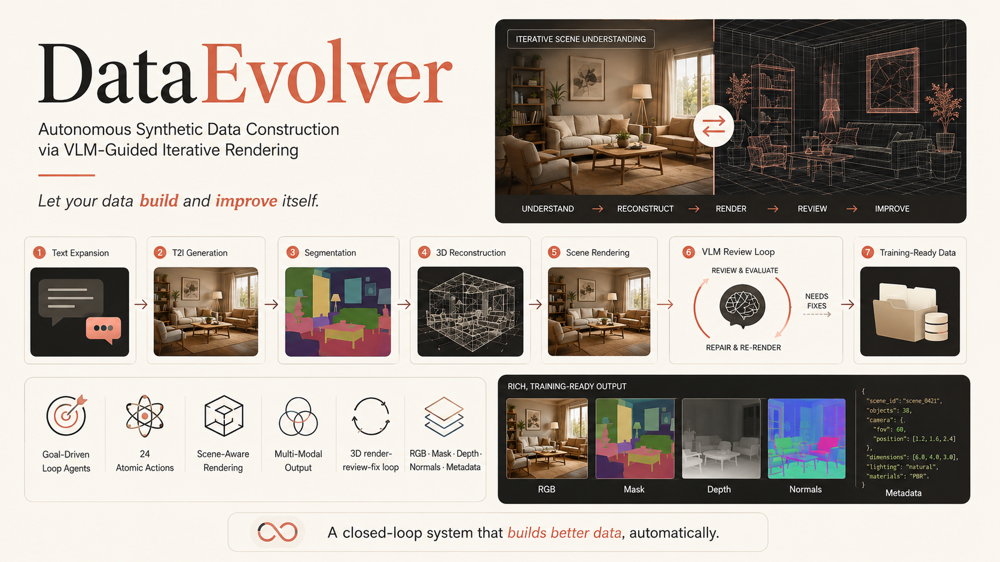
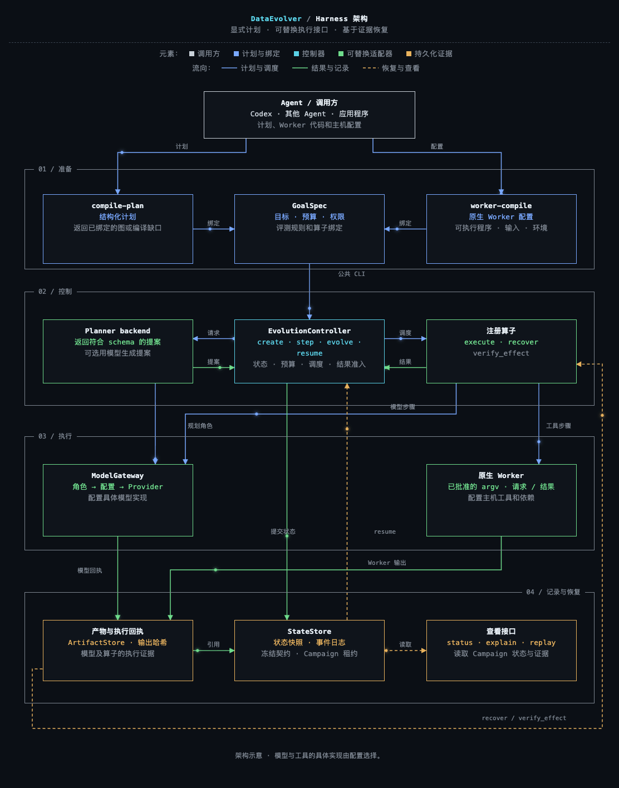
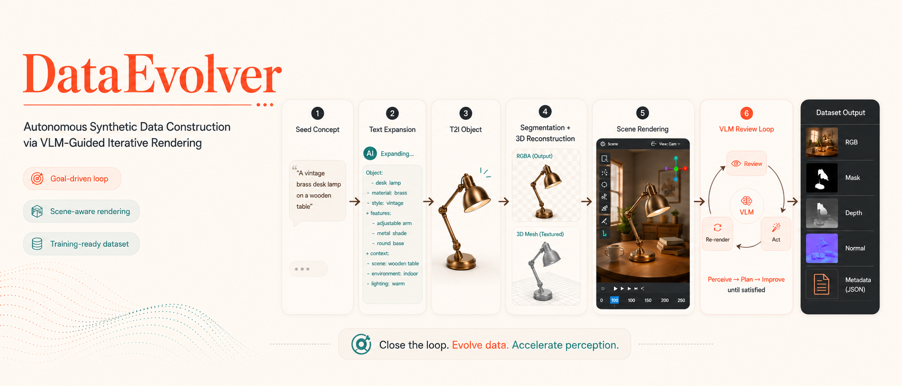
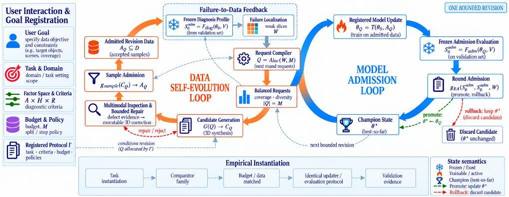

  

<h1 align="center">DataEvolver</h1>

  <strong>面向训练目标的多模态大模型图像与 3D 数据自动化自进化合成系统。</strong> 
  以训练目标组织生成、评价与数据修订。

  
  
  

  <a href="README.md">English</a> · <strong>简体中文</strong> ·
  <a href="#文档导航">文档导航</a> ·
  <a href="docs/zh-CN/quick-start.md">快速开始</a>

DataEvolver 围绕多模态大模型的训练目标组织图像与 3D 数据合成和修订。
Harness 连接数据处理、模型接口和原生工具。
外层 Agent 准备计划与代码，Controller 管理 Campaign 状态、执行记录和恢复。
部署选择放在私有配置中。

*原版项目海报展示早期渲染与审查设计。*

## DataEvolver 与 DataRSI

**DataEvolver 是工程项目，DataRSI 是后续研究工作。**
本仓库提供可供开发者 fork 并继续扩展的基础版本。
首份[技术报告](https://arxiv.org/abs/2605.01789)介绍早期目标驱动 Agent。
[DataRSI](https://github.com/PRIS-CV/DataRSI) 的标题是
*A 3D Data Harness for Failure-to-Data Evolution*，研究预算内的数据修订与模型准入。

早期 VLM 双循环保留在[历史分支](https://github.com/PRIS-CV/DataEvolver/tree/codex/legacy-vlm-dual-loop)。
研究结果和版本范围见[研究与项目沿革](docs/zh-CN/research.md)。

## 为什么是 DataEvolver？

数据构建需要兼容的算子、明确的进程输入输出，以及中断后可核对的运行证据。
DataEvolver 为这些环节提供共用契约和统一 Controller。
Agent 可以提出不同的数据工作流，执行过程仍复用同一套状态管理。

## 当前能力

| 范围 | 当前代码接口 |
|---|---|
| 数据工作流 | 注册的图像/目录数据图步骤、产物存储与验证。 |
| Agent 规划 | 结构化计划、显式模型角色绑定和预算内提案。 |
| 多模态工具 | 可选生成、编辑、提示增强、观察、审查和分割适配器。 |
| 3D 工作流 | 可选 Blender 建模/仿真/导出及 UE5 渲染 Worker。 |
| 研究准备 | 单论文或多论文证据会话与 handoff 导出。 |

这些是实现入口。所选主机与配置的部署可用性、输出质量需要分别验证。

图像收集与多主体布局清洗输出 `SourceBundle.v1` 和可独立读取的
`curated_images.v2`。详见[中文说明](docs/IMAGE_DATA_PIPELINES_zh.md)与
[服务器交接](docs/IMAGE_DATA_SERVER_HANDOFF.md)。当前已验证离线 fixtures；
真实采集与模型校准留待服务器。

Controller 统一管理状态、调度、预算与恢复，模型和原生工具通过明确的契约接入。
配置方式与现有约束见[部署及适配器限制](docs/zh-CN/deployment.md#本地配置与适配器限制)。

## 流水线概览

`GoalSpec` 绑定目标、算子、预算和评价规则。
Controller 调度执行、核对证据，并记录 Campaign 状态转换。

[打开完整交互 HTML](https://pris-cv.github.io/DataEvolver/architecture/zh.html) ·
[可编辑图规格](apps/project-page/frontend/architecture/zh.spec.json) ·
[执行与恢复指南](docs/zh-CN/harness.md)

架构图采用 [arch-diagram](https://github.com/bassnova42/arch-diagram-skill) 的默认设计。

## 项目网页与修复轨迹

[项目网站](https://pris-cv.github.io/DataEvolver/)展示渲染案例、研究图示和画廊。
[修复轨迹归档](https://pris-cv.github.io/DataEvolver/traces/?lang=zh)保留接地与瓶子计数的历史案例，
包括退化和未解决结果。这些案例不能证明新增训练收益。

[早期场景路线与图示](docs/zh-CN/research.md#项目沿革与展示) ·
[本地启动网站](docs/zh-CN/deployment.md#项目网站部署)

## DataRSI 研究更新

DataRSI 在声明的预算和回归检查下连接数据修订与模型准入。
论文报告的研究覆盖一次预算内修订。

[论文结果与适用范围](docs/zh-CN/research.md#datarsi-研究更新) ·
[研究仓库](https://github.com/PRIS-CV/DataRSI)

## DataEvolver-Rotate

原项目包含历史版本的旋转条件图像编辑数据集。
版本范围、数据划分和加载示例见[数据集说明](docs/zh-CN/research.md#dataevolver-rotate)。

## 文档导航

<!-- 已迁出的章节保留原 README 锚点，便于沿用旧链接。 -->

在仓库根目录执行 `./apps/workbench/launch.sh` 可启动可选的网页工作台。
环境要求与首次配置见[网页启动指南](docs/zh-CN/quick-start.md#网页工作台)，也可独立使用 Harness CLI。
启动器和网页位于 `apps/workbench/`，核心位于 `src/dataevolver/harness/`。

| 我想要…… | 指南 | 内容 |
|---|---|---|
| 在网页配置 Agent 并对话 | [私有工作台](docs/zh-CN/workbench.md) | `apps/workbench/` 下的可选应用与启动器；Agent 配置、图像接口、原生工具与 OpenSSH。 |
| 预检收集与清洗 Goal，审核导出样本 | [数据工作区](docs/zh-CN/data-workspace.md) | 复用图像流水线和 Campaign 控制；只读查看本机或 SSH 交付包。 |
| 探索与审阅候选工作流 | [候选方案编排](docs/zh-CN/orchestration.md) | 独立提案、新上下文证据复核、可配置 Worker 模型和有界派发。 |
| 从 DeepSeek Harness 使用 DataEvolver | [DSH 插件](plugins/dsh/README_zh.md) | 原生工具 Bundle、私有配置与既有 Campaign 命令。 |
| 准备源码环境 | [快速开始](docs/zh-CN/quick-start.md) | 网页启动、首次配置和独立 CLI 安装。 |
| 配置本地部署 | [模型、工具与部署](docs/zh-CN/deployment.md) | Profile、Provider、原生 Worker、本地设置和网站部署。 |
| 计划、执行或恢复任务 | [Harness 生命周期](docs/zh-CN/harness.md) | 编译、创建、推进、查看、暂停、恢复和回执。 |
| 通过 Codex 或其他 Agent 工作 | [Agent 接入](docs/zh-CN/agents.md) | 外层 Agent、内部规划 Provider 和可选 Claude Code 配置。 |
| Fork 并继续开发 | [开发与扩展](docs/zh-CN/development.md) | 目录职责、算子、工作流、评价策略、操作空间和迁移。 |
| 查看研究与数据集 | [研究与项目沿革](docs/zh-CN/research.md) | 研究结果、研究先验、Rotate、历史图示和引用。 |

每篇指南均提供英文版，并可返回本目录。
既有源码契约参考资料继续保留在 `docs/` 中。

## 荣誉展示

早期项目在 [AIDataSci 2026 / KDD Workshop](https://usail-hkust.github.io/aidatasci/accepted-papers.html)
列为 Poster Presentation，并获 2026 智源大会 Agent for Science 大赛海报展示证书。

  

[荣誉记录详情](docs/zh-CN/research.md#荣誉展示)

## 路线图

已有实现、待完成的主机验收及研究方向见[开发指南](docs/zh-CN/development.md#路线图)。

## 引用

首份 DataEvolver 技术报告的 [BibTeX 条目](docs/zh-CN/research.md#引用)保留在研究指南中。
DataRSI 的发布与引用信息见其[研究仓库](https://github.com/PRIS-CV/DataRSI)。

## 许可证

[Apache-2.0](LICENSE)
