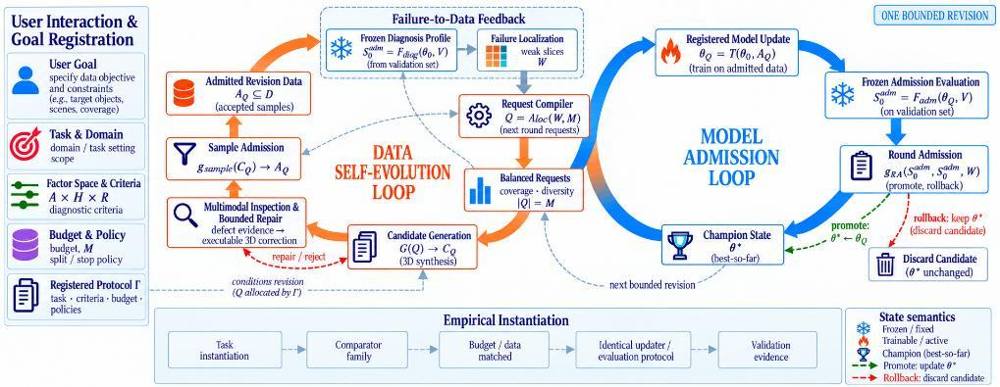
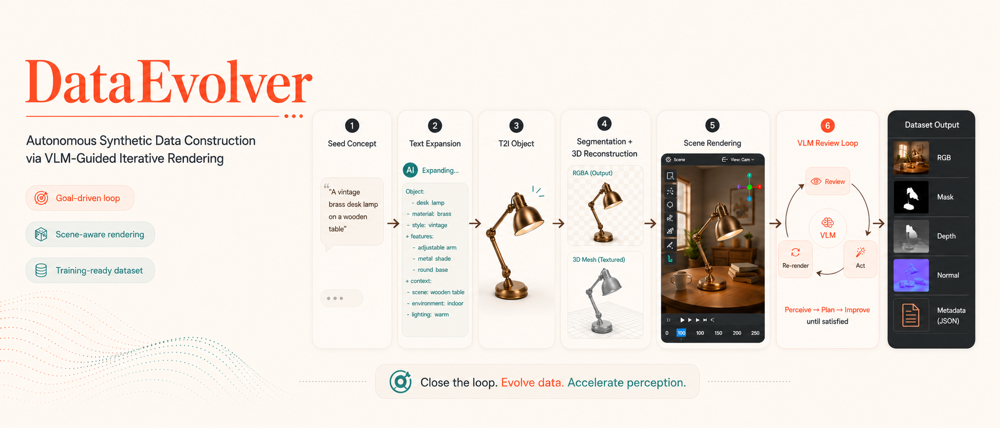
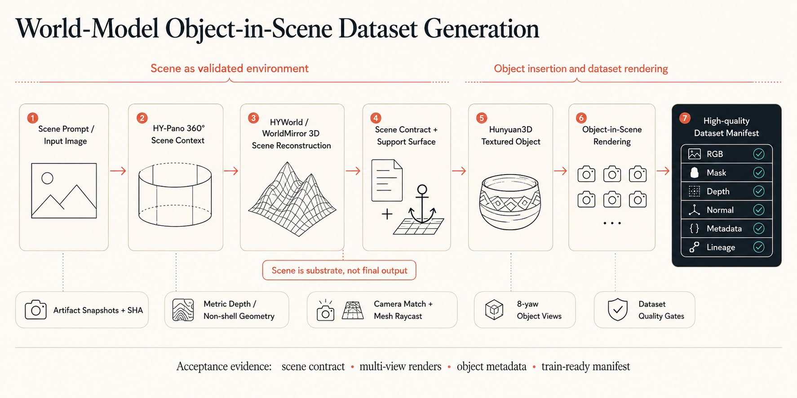

# Research, datasets and project history

[Home](../../README.md) · [Documentation index](../../README.md#documentation) · [简体中文](../zh-CN/research.md)

This guide preserves the manuscript results, historical datasets and earlier workflow illustrations. They do not establish new runtime validation of the current base.

Run command examples from the repository root unless a step changes directory.

## DataRSI research update

**Submitted to ICASSP 2027.** DataRSI connects a data revision loop with a model admission loop. VLM inspection supplies defect evidence, a registered policy applies bounded repairs, and deterministic sample contracts admit training pairs. Candidate model updates face target-utility and protected-region regression checks.



The manuscript compares Uniform-72 and Targeted-72 with **72 requests per arm**, the same candidate pool and training setup, and seeds **42, 43 and 44**. Evaluation uses **288 development pairs at 1024 × 1024**. Weak-4 denotes the four diagnosed camera-control cells. Values below are mean ± standard deviation across the three seeds.

| Metric | Uniform-72 | Targeted-72 |
|---|---|---|
| Weak-4 rotation error (°) ↓ | 50.45 ± 2.15 | 35.50 ± 3.23 |
| Weak-4 PSNR (dB) ↑ | 13.88 ± 0.07 | 14.43 ± 0.09 |
| Overall LPIPS ↓ | 0.2058 ± 0.0028 | 0.2014 ± 0.0030 |

Relative to Uniform, non-Weak-4 rotation error increases by **2.370 ± 0.046°**, and overall rotation error by **0.205 ± 0.125°**. Camera admission replay returns `Promote` for three targeted candidates against the frozen champion. The object-relocation case returns `Rollback` because protected spatial cells regress, despite all 18 samples being admitted and target utility passing.

These results cover **one bounded revision**, not repeated recursive improvement. The separate historical DataRSI-Bench comparison uses 384 pairs at 512 × 512; the original DataEvolver-Rotate dataset below contains 350 training pairs. These evaluations have different scopes. See the [website results section](https://pris-cv.github.io/DataEvolver/#results) for the repair and checkpoint figures. The numbers here are manuscript-reported results, not a new experiment run.

## Reproducible Research Prior Workflow

Stage0 prepares a research session for evidence collection and dataset planning.
The agent performs source discovery through its chosen search tools and records
sources; `init` creates the session, rather than performing an autonomous search
or starting a data-production campaign.

### Single-paper reproduction mode

```bash
dataevolver-stage0-web-research init \
  --query "paper title or dataset construction method" \
  --output-dir .dataevolver/local/research/single \
  --dataset-mode single-paper
```

Record the paper's dataset recipe, official resources, evaluation criteria and
missing evidence. Distinguish original resources from generated proxies.

### Multi-paper universal mode

```bash
dataevolver-stage0-web-research init \
  --query "shared dataset requirements across related papers" \
  --output-dir .dataevolver/local/research/universal \
  --dataset-mode universal
```

Use `add-evidence` to record sources, then `finalize` to export a research prior
and report; `validate` checks that prior. These are preparation interfaces in
[stage0_web_research.py](../../src/dataevolver/tools/stage0_web_research.py).
The resulting requirements still need registered operator/model/tool bindings
before `compile-plan` and campaign execution.

## DataEvolver-Rotate

Historical rotation-conditioned image-editing dataset, as reported in the original project materials. These counts describe that dataset version, not a new export from the current Harness.

| Metric | Value |
|--------|-------|
| Unique Objects | 50 |
| Rotation Angles | 8 (0&deg;, 45&deg;, 90&deg;, 135&deg;, 180&deg;, 225&deg;, 270&deg;, 315&deg;) |
| Training Pairs | 350 (front &rarr; 7 target views) |
| Train / Val / Test | 245 / 49 / 56 pairs (object-disjoint, seed=42) |
| Modalities | RGB, mask, depth, normal |

### Methodology

Each object uses a single **canonical yaw-0&deg; best state** as the base. The object is then rotated while the scene, camera, lighting, and material remain fixed to preserve the scene conditions across angles.

### Loading the Dataset

```python
import json
from pathlib import Path
from PIL import Image

root = Path("path/to/dataset_split")
rows = []
with (root / "pairs" / "train_pairs.jsonl").open("r") as f:
    for line in f:
        rows.append(json.loads(line))

row = rows[0]
source = Image.open(root / row["source_image"]).convert("RGB")
target = Image.open(root / row["target_image"]).convert("RGB")
instruction = row["instruction"]  # e.g., "Rotate the object 45 degrees clockwise"
```

## Project history and visuals

The [project website](https://pris-cv.github.io/DataEvolver/) retains rendering
examples, research materials and repair traces. The first
[DataEvolver technical report](https://arxiv.org/abs/2605.01789) describes an earlier
revision; [DataRSI](https://github.com/PRIS-CV/DataRSI) is the subsequent research
repository. See the [project/publication guide](../DATARSI_RELATION.md).

**Historical showcase — the earlier VLM render/review workflow.** This original
README illustration documents the project's origins. The
[Pipeline Overview](../../README.md#pipeline-overview) describes the current Harness architecture.



<details>
<summary>Earlier object-in-scene route</summary>

The object-in-scene illustration shows an earlier HYWorld / Hunyuan3D route and
its intended dataset outputs. Refer to the native workflow guide for the current
Blender/UE5 interfaces.



</details>

### Repair traces and comparison limits

The [project website](https://pris-cv.github.io/DataEvolver/) presents engineering
routes, research figures and a rendering gallery. Its
[trace page](https://pris-cv.github.io/DataEvolver/traces/?lang=en) retains historical
ground-contact and bottle-count repairs, including regressions and unresolved
outcomes. The separate Qwen/FLUX comparison uses different generators; these
materials do not establish a continuous improvement run or new training gains.

### The VLM Review Loop (Stage 5)

The earlier scene workflow used VLM feedback to select bounded rendering repairs;
its [Stage 5 diagram](../../apps/project-page/frontend/images/readme/stage5.svg) and
[pipeline illustration](../../apps/project-page/frontend/images/readme/pipeline_show.svg)
remain available. In the current base, review is an optional model step and repair
requires a registered action, evaluator and budget. Those diagrams describe the
historical workflow; they do not prescribe a second Controller.

## Citation

This entry cites the **first DataEvolver technical report on arXiv**. DataRSI is a subsequent submission; consult its [research repository](https://github.com/PRIS-CV/DataRSI) for release and citation updates.

```bibtex
@misc{zhang2026dataevolverletdatabuild,
  title={DataEvolver: Let Your Data Build and Improve Itself via Goal-Driven Loop Agents},
  author={Qisong Zhang and Wenzhuo Wu and Zhuangzhuang Jia and Yunhao Yang and Huayu Zhang and Xianghao Zang and Zhixiang He and Zhongjiang He and Kongming Liang and Zhanyu Ma},
  year={2026},
  eprint={2605.01789},
  archivePrefix={arXiv},
  primaryClass={cs.AI},
  url={https://arxiv.org/abs/2605.01789},
}
```

## Honors & Recognition

- **AIDataSci 2026, KDD 2026 Workshop:** the current
  [official accepted-paper list](https://usail-hkust.github.io/aidatasci/accepted-papers.html)
  lists DataEvolver under **Poster Presentations**. This corrects the earlier
  README's Oral label.
- **2026 BAAI Conference Agent for Science Competition:** Certificate of Poster
  Presentation, reproduced below. These recognitions concern the earlier project.

<p align="center">
  
</p>
