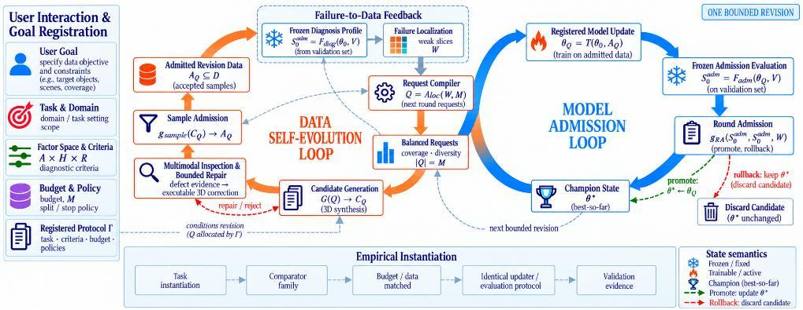
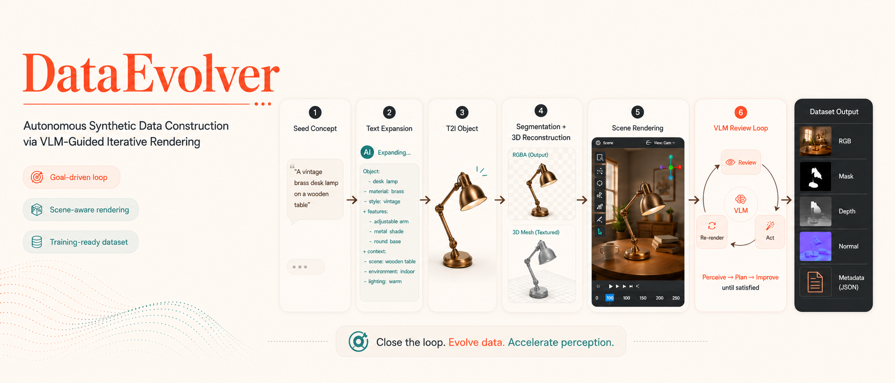
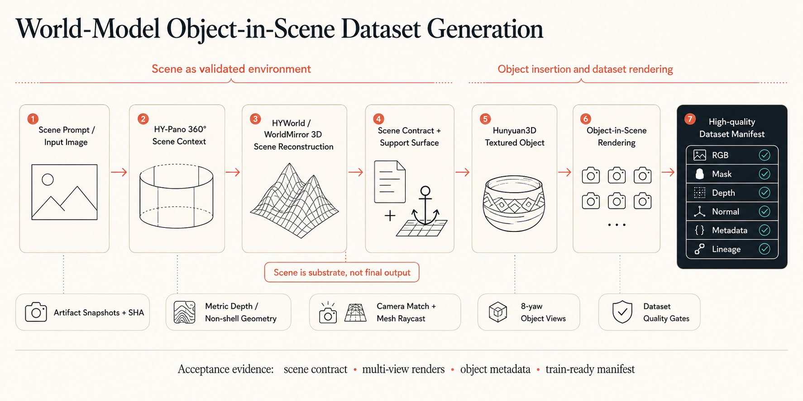
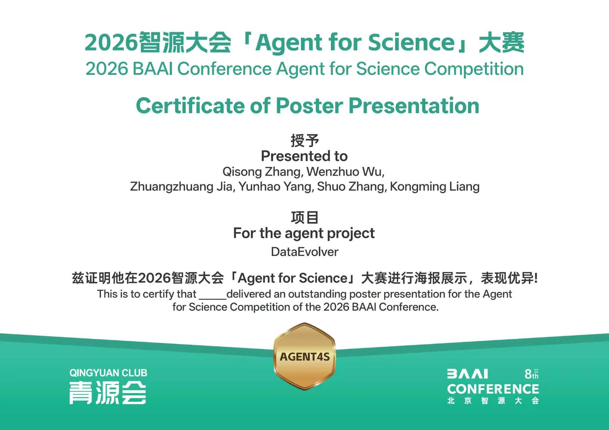

# 研究、数据集与项目沿革

[首页](../../README_zh.md) · [文档目录](../../README_zh.md#文档导航) · [English](../en/research.md)

本页保留论文结果、历史数据集和早期流程图。它们不代表当前基础版本完成了新的运行验收。

除明确要求切换目录的步骤外，命令示例均从仓库根目录执行。

## DataRSI 研究更新

**已投稿至 ICASSP 2027。** DataRSI 连接数据修订循环与模型准入循环。VLM 检查提供缺陷证据，已注册的策略在预算内修复，确定性样本合同决定训练样本准入。候选模型更新须通过目标效用与受保护区域的回归检查。



论文比较 Uniform-72 与 Targeted-72，**每组使用 72 次请求**，训练设置和候选池相同，种子为 **42、43、44**。评测采用 **288 对开发样本，分辨率为 1024 × 1024**。Weak-4 是诊断出的四个相机控制单元。下表为三个种子的均值 ± 标准差。

| 指标 | Uniform-72 | Targeted-72 |
|---|---|---|
| Weak-4 旋转误差（°）↓ | 50.45 ± 2.15 | 35.50 ± 3.23 |
| Weak-4 PSNR（dB）↑ | 13.88 ± 0.07 | 14.43 ± 0.09 |
| 整体 LPIPS ↓ | 0.2058 ± 0.0028 | 0.2014 ± 0.0030 |

相对 Uniform，非 Weak-4 区域旋转误差增加 **2.370 ± 0.046°**，整体旋转误差增加 **0.205 ± 0.125°**。相机准入回放将三个定向候选与冻结的基准模型比较，均返回 `Promote`。物体移动案例虽然 18 个样本全部准入、目标效用达到要求，但受保护空间单元出现回退，因此返回 `Rollback`。

这些结果覆盖**一次预算内的修订**。论文尚未证明多轮递归改进。另一组历史 DataRSI-Bench 评测采用 384 对样本、512 × 512 分辨率；下文的原始 DataEvolver-Rotate 数据集包含 350 对训练样本。几组评测各有适用范围。修复图与历史检查点对比图见[网页结果区](https://pris-cv.github.io/DataEvolver/#results)。以上数字来自论文稿件，本页不报告新增实验。

## 可复现 Research Prior 工作流

Stage0 为证据收集和数据集规划创建研究会话。Agent 使用选定的搜索工具查找来源并记录证据。
`init` 只创建会话，不自动联网搜索，也不启动数据生产 Campaign。

### 单论文复现模式

```bash
dataevolver-stage0-web-research init \
  --query "paper title or dataset construction method" \
  --output-dir .dataevolver/local/research/single \
  --dataset-mode single-paper
```

记录论文的数据构建方法、官方资源、评测标准和证据缺口，区分原始资源与自行生成的替代数据。

### 多论文通用模式

```bash
dataevolver-stage0-web-research init \
  --query "shared dataset requirements across related papers" \
  --output-dir .dataevolver/local/research/universal \
  --dataset-mode universal
```

使用 `add-evidence` 记录来源，`finalize` 导出研究先验和报告，`validate` 检查先验。
这些准备接口位于 [stage0_web_research.py](../../src/dataevolver/tools/stage0_web_research.py)。
形成的数据需求仍需绑定注册算子、模型和工具，再通过 `compile-plan` 及 Campaign 接口执行。

## DataEvolver-Rotate

原项目材料记录的旋转条件图像编辑数据集。下表属于该历史数据版本，不是当前 Harness 新导出的结果。

| 指标 | 数值 |
|------|------|
| 物体数量 | 50 |
| 旋转角度 | 8 (0&deg;, 45&deg;, 90&deg;, 135&deg;, 180&deg;, 225&deg;, 270&deg;, 315&deg;) |
| 训练对数量 | 350 (正面 → 7 个目标视角) |
| 训练 / 验证 / 测试 | 245 / 49 / 56 对 (物体隔离，seed=42) |
| 模态 | RGB、mask、depth、normal |

### 构建方法

每个物体以唯一的 **canonical yaw-0&deg; best state** 为基准。
旋转物体时，场景、相机、光照和材质保持固定。

### 加载数据集

```python
import json
from pathlib import Path
from PIL import Image

root = Path("path/to/dataset_split")
rows = []
with (root / "pairs" / "train_pairs.jsonl").open("r") as f:
    for line in f:
        rows.append(json.loads(line))

row = rows[0]
source = Image.open(root / row["source_image"]).convert("RGB")
target = Image.open(root / row["target_image"]).convert("RGB")
instruction = row["instruction"]  # 例如："将物体顺时针旋转 45 度"
```

## 项目沿革与展示

[项目网站](https://pris-cv.github.io/DataEvolver/)保留了渲染示例、研究材料和修复轨迹。
首份 [DataEvolver 技术报告](https://arxiv.org/abs/2605.01789)描述较早版本；
[DataRSI](https://github.com/PRIS-CV/DataRSI) 是后续研究仓库，关系说明见[项目与论文指南（英文参考）](../DATARSI_RELATION.md)。

**历史展示：早期 VLM 渲染/审查流程。** 保留旧 README 插图，用于介绍项目来源。
当前 Harness 架构见[流水线概览](../../README_zh.md#流水线概览)。



<details>
<summary>早期物体入场景路线</summary>

下面的物体入场景示意图展示早期 HYWorld / Hunyuan3D 路线及其预期数据输出。
当前 Blender/UE5 接口以原生工作流指南为准。



</details>

### 修复轨迹与对比范围

[项目网站](https://pris-cv.github.io/DataEvolver/)展示工程路线、研究图示和渲染画廊。
[修复轨迹页](https://pris-cv.github.io/DataEvolver/traces/?lang=zh)保留接地与瓶子计数的历史案例，
包括退化和未解决结果。单独的 Qwen/FLUX 对比使用不同生成器；这些材料不能证明连续改进过程或新增训练收益。

### VLM 审查闭环（Stage 5）

早期场景流程用 VLM 反馈选择预算内的渲染修复，保留的
[Stage 5 图](../../apps/project-page/frontend/images/readme/stage5.svg)和
[流水线图](../../apps/project-page/frontend/images/readme/pipeline_show.svg)描述该历史流程。
当前基础版本将审查作为可选模型步骤，修复需要注册动作、评测规则和预算，不额外引入一套 Controller。

## 引用

下方条目引用的是**第一版 arXiv DataEvolver 技术报告**。DataRSI 是后续投稿论文，发布与引用信息请查阅其[论文仓库](https://github.com/PRIS-CV/DataRSI)。

```bibtex
@misc{zhang2026dataevolverletdatabuild,
  title={DataEvolver: Let Your Data Build and Improve Itself via Goal-Driven Loop Agents},
  author={Qisong Zhang and Wenzhuo Wu and Zhuangzhuang Jia and Yunhao Yang and Huayu Zhang and Xianghao Zang and Zhixiang He and Zhongjiang He and Kongming Liang and Zhanyu Ma},
  year={2026},
  eprint={2605.01789},
  archivePrefix={arXiv},
  primaryClass={cs.AI},
  url={https://arxiv.org/abs/2605.01789},
}
```

## 荣誉展示

- **AIDataSci 2026，KDD 2026 Workshop：** 当前
  [官方录用列表](https://usail-hkust.github.io/aidatasci/accepted-papers.html)
  将 DataEvolver 列为 **Poster Presentation**，据此更正旧 README 的 Oral 标注。
- **2026 智源大会 Agent for Science 大赛：** 获海报展示证书，见下图。这些记录属于早期项目。

<p align="center">
  
</p>
